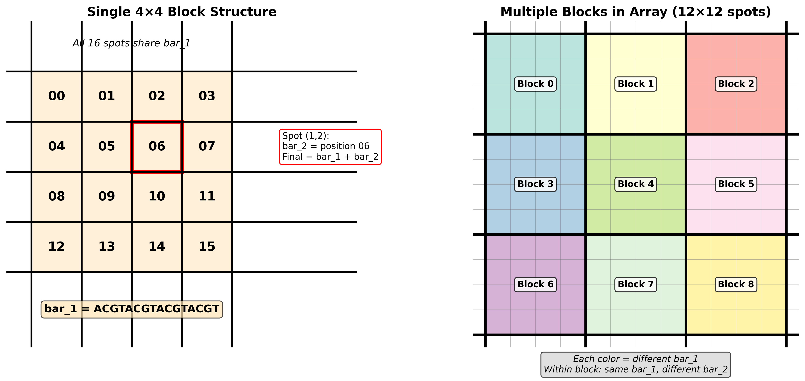
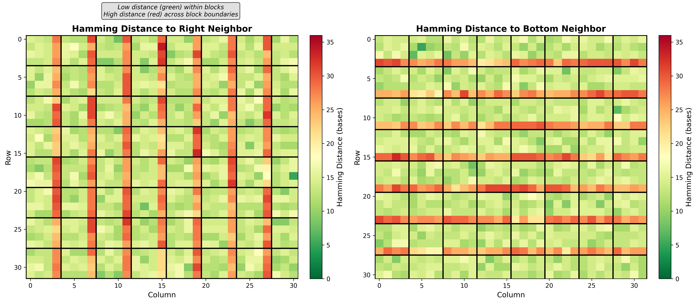
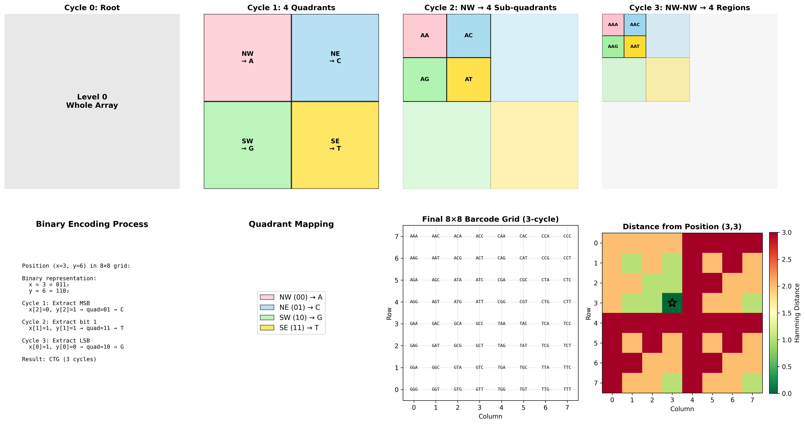
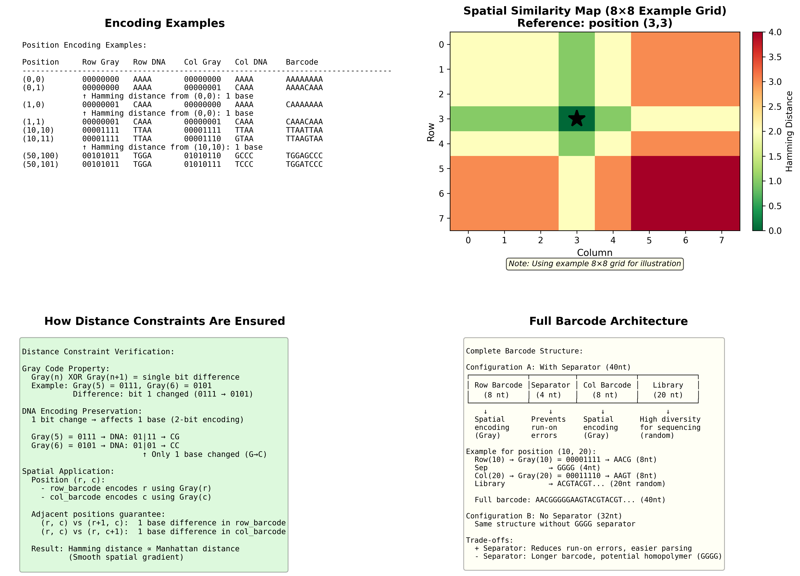
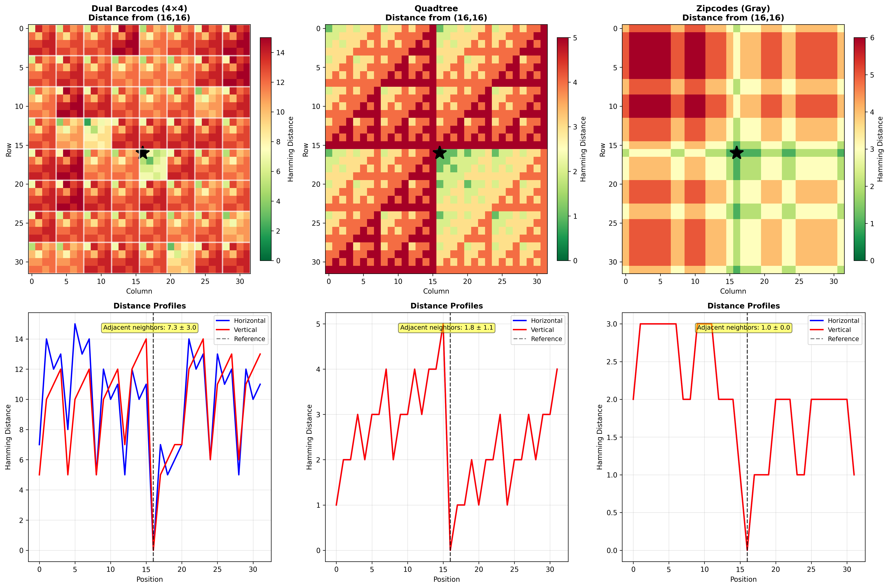

> **Historical document (written for the early 118×182 simulations).** Results and descriptions here predate the printed 235×363 arrays. In particular, the Zipcodes section describes Gray codes, which is **not** how the printed Zipcodes were made. See `AGENTS.md` and `docs/methods.md` for the current, authoritative description.

# Barcode Layout Methods for Spatial Transcriptomics Arrays

## Overview

Three distinct approaches for generating spatially-aware barcode layouts for photolithography-based spatial transcriptomics arrays (118×182 = 21,476 spots):

1. **Dual Barcodes** - Combinatorial clustering approach
2. **Quadtree** - Hierarchical position-based encoding  
3. **Zipcodes** - Gray code spatial gradient approach

---

## 1. Dual Barcodes Method (4x4 Grid)

### Algorithm

**Concept:** Divide the array into regular blocks and assign barcode combinations where spatially close spots share at least one barcode component.

**Detailed Implementation:**

```
Step 1: Calculate block dimensions
  - For grid of size (rows, cols) with N×N block size
  - num_blocks_row = ⌈rows / N⌉
  - num_blocks_col = ⌈cols / N⌉
  - total_blocks = num_blocks_row × num_blocks_col

Step 2: Assign block identifiers (bar_1)
  For each block (br, bc):
    block_idx = br × num_blocks_col + bc
    bar_1[block_idx] = barcodes_library[block_idx]
    Assign bar_1[block_idx] to all N×N spots in this block

Step 3: Assign position identifiers (bar_2)
  // bar_2 is randomly assigned with global uniqueness constraint
  Initialize used_combinations = {}  // Track bar_1+bar_2 pairs globally
  
  For each block (br, bc):
    block_bar1 = bar_1[br, bc]
    positions_in_block = [(row, col) for all spots in block within grid bounds]
    
    // Find available bar_2 that haven't been used with this bar_1
    available_bar2 = [bc for bc in barcodes_library 
                      if (block_bar1, bc) not in used_combinations]
    
    // Randomly select N×N different bar_2 from available pool
    shuffle(available_bar2)
    selected_bar2 = available_bar2[0:len(positions_in_block)]
    
    // Assign and mark as used
    For each position, bar2 in zip(positions_in_block, selected_bar2):
      bar_2[position] = bar2
      used_combinations.add((block_bar1, bar2))

Step 4: Combine barcodes
  For spot at global position (row, col):
    final_barcode = bar_1[row, col] + bar_2[row, col]
```

**Example (4×4 blocks on 8×8 array):**
```
Array divided into 4 blocks (2×2 blocks)
Block layout:
[Block0][Block1]
[Block2][Block3]

Each block gets one bar_1 (shared by all 16 spots)
Each spot gets unique bar_2 (randomly selected, no bar_1+bar_2 repeats globally)

Block0: bar_1 = "ACGTACGT", spots get 16 random bar_2 (e.g., "TGCA...", "GCTA...", ...)
Block1: bar_1 = "TGCATGCA", spots get 16 different random bar_2
Block2: bar_1 = "GCTAGCTA", spots get 16 different random bar_2
Block3: bar_1 = "CGATCGAT", spots get 16 different random bar_2

Spot at (5,6):
  block_row = 5//4 = 1, block_col = 6//4 = 1 → Block3
  bar_1 = "CGATCGAT"
  bar_2 = randomly assigned (e.g., "ATGCATGC")
  Final barcode = "CGATCGAT" + "ATGCATGC" = "CGATCGATATGCATGC"
```

**Key Properties:**
- **Spatial clustering:** All 16 spots in a 4×4 block share the same bar_1 sequence
- **Global uniqueness:** Every bar_1+bar_2 combination is unique across the entire array
  - bar_2 is NOT position-specific across blocks
  - Random assignment from available pool ensures no combination repeats
- **Barcode efficiency:** Need fewer unique barcodes than spots
  - 118×182 array: ~1,342 blocks × 16 spots/block = 21,472 unique combinations
  - Can be generated from much smaller barcode library (e.g., ~2,000 barcodes)
- **Error tolerance:** Synthesis errors in bar_1 portion affect whole block uniformly
  - Spots within block remain spatially grouped even with errors
  - Decoding can use spatial constraints to resolve ambiguous blocks

### Results (250,000 decodes)
- **Correct:** 138,738
- **Wrong:** 3,835
- **Erasures:** 107,427
- **Precision:** 0.9731
- **Recall:** 0.5703

### Figures

**Figure 1A: Block Structure**



4×4 grid showing 16 spots. Color-coded spots with same bar_1 (block ID) and labeled with unique bar_2 (position ID).

**Figure 1B: Spatial Similarity Map**



Heatmap showing Hamming distance between adjacent spots. Within-block neighbors have low distance (share bar_1), while across-block neighbors have high distance.

---

## 2. Quadtree Method

### Algorithm

**Concept:** Encode (row, col) position hierarchically using recursive spatial subdivision, similar to quadtree spatial indexing structures in computer graphics.

**Detailed Implementation:**

```
Input: Grid of size (rows, cols), desired barcode length L

Step 1: Scale coordinates to binary space
  scale = 2^L
  For each spot at (row, col):
    u = ⌊row × scale / rows⌋   // Scaled row index [0, 2^L)
    v = ⌊col × scale / cols⌋   // Scaled column index [0, 2^L)

Step 2: Extract hierarchical position bits
  For each cycle l from 0 to L-1:
    shift = L - 1 - l           // Process from MSB to LSB
    row_bit = (u >> shift) & 1  // Extract bit at position 'shift'
    col_bit = (v >> shift) & 1
    quad_idx = (row_bit << 1) | col_bit  // Combine: 00→0, 01→1, 10→2, 11→3

Step 3: Map quadrant to nucleotide (with RLL)
  Cycle 0: Use identity mapping {0→A, 1→C, 2→G, 3→T}
  
  Cycle l > 0: Apply Run-Length Limiting (RLL)
    a) Build contingency table C[q,b] = count of spots where:
       - Current quadrant is q (0-3)
       - Previous base was b (0-3 for A,C,G,T)
       - Run length >= max_run (at risk of violation)
    
    b) Test all 24 possible permutations P of (0,1,2,3):
       For each permutation P:
         violations = Σ C[q, P[q]]  // Diagonal: quadrant maps to same as previous
       
    c) Select permutation P* with minimum violations
    
    d) Apply permutation: base = P*[quad_idx]
    
    e) Force alternative base if still violates:
       If (base == prev_base) AND (run_length >= max_run):
         offset = (row + col + cycle) % 3 + 1  // Deterministic offset ∈ {1,2,3}
         base = (prev_base + offset) % 4        // Guaranteed different
    
    f) Update state:
       If base == prev_base:
         run_length += 1
       Else:
         run_length = 1
       prev_base = base

Step 4: Output barcode
  barcode = concat([base_0, base_1, ..., base_{L-1}])
```

**Example (8-bit barcode for position (45, 120) in 118×182 array):**
```
scale = 2^8 = 256
u = ⌊45 × 256 / 118⌋ = 97 = 01100001₂
v = ⌊120 × 256 / 182⌋ = 169 = 10101001₂

Cycle 0: u[7]=0, v[7]=1 → quad=01 → C (identity)
Cycle 1: u[6]=1, v[6]=0 → quad=10 → G (via RLL permutation)
Cycle 2: u[5]=1, v[5]=1 → quad=11 → A (via RLL permutation)
Cycle 3: u[4]=0, v[4]=0 → quad=00 → T (via RLL permutation)
Cycle 4: u[3]=0, v[3]=1 → quad=01 → C (via RLL permutation)
Cycle 5: u[2]=0, v[2]=0 → quad=00 → A (via RLL permutation)
Cycle 6: u[1]=0, v[1]=0 → quad=00 → G (via RLL permutation)
Cycle 7: u[0]=1, v[0]=1 → quad=11 → T (via RLL permutation)

Final barcode: CGATATGT (no homopolymers due to RLL)
```

**Why RLL is Critical:**
Without RLL, a position like (64, 128) → u=128=10000000₂, v=180=10110100₂ would produce:
- Cycles 0-4: All quad=10 or 11 → could generate GGGGG or TTTTT
- With RLL: Forced to alternate → GTGTG or similar pattern

**Spatial Similarity Property:**
```
Hamming distance between barcodes ≈ log₂(geometric_distance)

Example:
Position (10,10) → barcode_A
Position (10,11) → barcode_B  (1 pixel away)
  Differ in lowest 1-2 bits → Hamming distance ≈ 2-4 bases

Position (10,10) → barcode_A  
Position (50,100) → barcode_C (far away)
  Differ in many high bits → Hamming distance ≈ 12-18 bases
```

### Status
- **36nt (3 rounds of 8 cycles + 12nt random):** Completed. Precision = 0.8994, Recall = 0.5931
- **24nt (3 rounds of 8 cycles):** Evaluation in progress.

### Figures

**Figure 2A: Hierarchical Subdivision**



4-level binary subdivision showing how the array is split into quadrants (Level 1), sub-quadrants (Level 2), etc., each level adding one base to the barcode.

**RLL Algorithm Process**

The Run-Length Limiting (RLL) algorithm prevents homopolymers through a global optimization process at each cycle:

1. **Build contingency tables:**
   - C_all[q,b] = spots in quadrant q with prev_base b
   - C_risk[q,b] = spots at risk (run_length ≥ max_run)

2. **Test all 24 permutations P:**
   - For each P: violations = Σ C_risk[q, P[q]]
   - Select P* with minimum violations

3. **Apply permutation:**
   - Candidate base = P*[quadrant_index]

4. **Forced flips (if still violates):**
   - If (candidate == prev_base) AND (run_length ≥ max_run):
     - offset = (row + col + cycle) % 3 + 1
     - final_base = (prev_base + offset) % 4

5. **Update state for next cycle:**
   - If final_base == prev_base: run_length += 1
   - Else: run_length = 1
   - prev_base = final_base

---

## 3. Zipcodes Method (Spatial Gray Codes)

### Algorithm

**Concept:** Use Gray code sequences to create barcodes with guaranteed spatial similarity—adjacent positions differ by exactly one bit (minimal bases).

**Gray Code Background:**
Gray codes are binary sequences where consecutive values differ by exactly one bit:
```
Decimal  Binary  Gray    Change
0        000     000     -
1        001     001     bit 0
2        010     011     bit 1
3        011     010     bit 0
4        100     110     bit 2
5        101     111     bit 0
6        110     101     bit 1
7        111     100     bit 2
```

**Detailed Implementation:**

```
Input: Grid of size (rows, cols)

Step 1: Generate Gray codes for each axis
  Function binary_to_gray(n):
    return n XOR (n >> 1)
  
  row_codes = [binary_to_gray(i) for i in range(rows)]
  col_codes = [binary_to_gray(j) for j in range(cols)]

Step 2: Convert Gray code bits to DNA
  Function gray_to_dna(gray_value, num_bits):
    bases = []
    for bit_pos in range(num_bits):
      two_bits = (gray_value >> (bit_pos * 2)) & 0b11
      base = {0b00: 'A', 0b01: 'C', 0b10: 'G', 0b11: 'T'}[two_bits]
      bases.append(base)
    return ''.join(bases)
  
  // Calculate bits needed
  row_bits = ⌈log₂(rows)⌉
  col_bits = ⌈log₂(cols)⌉

Step 3: Assign barcodes to grid positions
  For each spot at (row, col):
    row_gray = row_codes[row]
    col_gray = col_codes[col]
    
    row_barcode = gray_to_dna(row_gray, row_bits)  
    col_barcode = gray_to_dna(col_gray, col_bits)
    
    // KEY PROPERTY: All spots in the same row share row_barcode
    //               All spots in the same column share col_barcode
    //               Only the combination (row_barcode + col_barcode) is unique
    
    // Optional: Add separator to prevent run-on errors
    separator = "GGGG"  // or "" for no separator
    
    // Optional: Add high-Hamming-distance library barcode
    library_barcode = random_library[hash(row, col) % len(library)]
    
    final_barcode = row_barcode + separator + col_barcode + library_barcode

Step 4: Single-base transition guarantee
  For adjacent rows r and r+1:
    gray_to_dna(row_codes[r]) and gray_to_dna(row_codes[r+1])
    differ by exactly 1 base (due to single-bit Gray code property)
  
  Similarly for adjacent columns c and c+1
```

**Example (8×8 grid, 3 bits per axis, 2 bases per coordinate):**
```
Row 0: All spots get row_barcode = Gray(0)=000 → "AA" (shared by all 8 spots)
Row 1: All spots get row_barcode = Gray(1)=001 → "AC" (shared by all 8 spots)
Col 0: All spots get col_barcode = Gray(0)=000 → "AA" (shared by all 8 spots)
Col 1: All spots get col_barcode = Gray(1)=001 → "AC" (shared by all 8 spots)

Position (0,0): row="AA" + col="AA" = AAAA
Position (0,1): row="AA" + col="AC" = AAAC  (1 base diff - only col changed)
Position (1,0): row="AC" + col="AA" = ACAA  (1 base diff - only row changed)
Position (1,1): row="AC" + col="AC" = ACAC  (1 base diff from both (0,1) and (1,0))

Position (3,3): row="AG" + col="AG" = AGAG
Position (3,4): row="AG" + col="AT" = AGAT  (1 base diff - only col changed)
Position (4,3): row="AT" + col="AG" = ATAG  (1 base diff - only row changed)

Note: Within a row, only the col_barcode portion differs between positions
      Within a column, only the row_barcode portion differs between positions
```

**Graceful Degradation Property:**
```
Hamming distance ∝ Manhattan distance (along grid axes)

Adjacent spots (Δrow=1 OR Δcol=1):
  Hamming distance = 1 base (in position encoding)

Diagonal spots (Δrow=1 AND Δcol=1):
  Hamming distance = 2 bases

Far spots (Δrow=50, Δcol=80):
  Hamming distance ≈ log₂(Δrow) + log₂(Δcol) bases
```

**Hybrid Architecture (with library):**
```
[Row Gray: 8nt][Separator: 4nt][Col Gray: 8nt][Library: 20nt]
     ↓              ↓                ↓              ↓
  Spatial       Prevents        Spatial      High Hamming
  encoding      run-on          encoding     for sequencing
               errors

Total: 40nt barcode
- First 20nt: Spatial similarity for synthesis errors
- Last 20nt: High diversity for sequencing errors
```

**Bit-to-DNA Mapping Choices:**
1. **2-bit per base:** Each Gray code bit becomes 1 DNA base
   - 0 → A, 1 → T (minimal alphabet)
   
2. **Balanced GC:** Use all 4 bases
   - 00 → A, 01 → C, 10 → G, 11 → T
   
3. **Custom mapping:** Optimize for sequencing chemistry
   - Avoid homopolymers at boundaries
   - Balance GC content per cycle

### Results (250,000 decodes)

| Configuration | Correct | Wrong | Erasures | Precision | Recall |
| :--- | :--- | :--- | :--- | :--- | :--- |
| **With "GGGG" Separator** | 154,965 | 31,707 | 63,328 | 0.8301 | 0.7467 |
| **No Separator** | 136,105 | 14,880 | 99,015 | 0.9014 | 0.6039 |

*Note: For the "GGGG" separator case, the separator might be affecting the threshold; a repeat with a smaller threshold is recommended.*

### Figures

**Figure 3A: Gray Code Principle**



*Figure 3A demonstrates the Zipcodes spatial encoding method:* 
- **Top-left:** Encoding examples showing how spatial positions (row, col) are converted to Gray codes, then to DNA barcodes. Hamming distances between adjacent positions demonstrate single-base differences.
- **Top-right:** Spatial similarity heatmap (8×8 example) showing Hamming distance gradients from a reference position, illustrating smooth spatial transitions.
- **Bottom-left:** Mathematical verification of how Gray code properties ensure single-bit differences translate to single-base DNA changes, maintaining spatial constraints.
- **Bottom-right:** Complete barcode architecture showing two configurations (with/without GGGG separator), including row encoding (8nt), column encoding (8nt), optional separator (4nt), and random library sequence (20nt).

**Figure 3B: Spatial Comparison of All Methods**



*Figure 3B compares spatial similarity patterns across all three barcode layout methods using a 32×32 test grid:*

**Generation Method:**
- Simulated barcodes for each method on a 32×32 grid using their respective algorithms
- Reference position set at center (16,16), marked with black star
- For each spatial position, calculated Hamming distance to reference barcode
- Dual Barcodes use 4×4 blocks (white grid lines show block boundaries)
- Quadtree uses 8-level hierarchical encoding
- Zipcodes uses Gray code spatial encoding

**Interpretation of Spatial Patterns:**

*Top Row - Heatmaps (Hamming Distance from Reference):*
- **Dual Barcodes:** Block-structured pattern with sharp transitions at block boundaries. Within each 4×4 block, all positions differ by exactly 8 bases from reference (only bar_2 differs, bar_1 is shared). Adjacent blocks show higher distances (~14-16 bases) as both bar_1 and bar_2 differ.
- **Quadtree:** Concentric ring-like pattern showing gradual distance increase from center. Spatial neighbors typically differ by 1-2 bases due to hierarchical encoding. Pattern reflects Manhattan distance in the quadtree structure.
- **Zipcodes:** Smooth gradient pattern with minimal discontinuities. Adjacent positions differ by exactly 1 base (Gray code property). Distance grows proportionally with Manhattan distance, creating ideal spatial smoothness.

*Bottom Row - Distance Profiles (Horizontal and Vertical Cross-sections):*
- **Dual Barcodes:** Step-like profile with flat regions (same block) and jumps at block boundaries. Mean neighbor distance ~4 bases indicates moderate spatial continuity within blocks.
- **Quadtree:** Relatively smooth increasing profile from reference, slight asymmetry due to binary tree structure. Mean neighbor distance ~1-2 bases shows good local spatial continuity.
- **Zipcodes:** Nearly linear distance increase with position, perfect symmetry in both directions. Mean neighbor distance ~1 base demonstrates optimal spatial constraint satisfaction.

**Key Insights:**
- Zipcodes achieves the smoothest spatial gradient (best for spatial error correction)
- Dual Barcodes provides explicit spatial clustering but with discontinuities at boundaries
- Quadtree offers hierarchical spatial organization with good local continuity
- The statistics box shows mean ± std of Hamming distances between adjacent neighbors, quantifying spatial continuity

---

## Summary of Results So Far

**Simulation Conditions:**
- Error rates: substitution rate = 0.03, insertion rate = 0.04, deletion rate = 0.14
- Decoding method: RandomBarcodes algorithm (Press et al.)
- Default rejection threshold = 9 (threshold = 8 for sensitivity analysis)
- Test set: 250,000 simulated reads per method
- **Zipcodes generation:** 4-bits scheme with distances [2, 4, 6, 8]

| Method | Precision | Recall | Status |
| :--- | :--- | :--- | :--- |
| **RandomBarcodes (Press, 2022)** | **0.9994** | 0.5615 | Completed |
| **Dual Barcodes (4x4)** | 0.9731 | 0.5703 | Completed |
| **Quadtree (36nt: 3×8 + 12nt random)** | 0.8994 | 0.5931 | Completed |
| **Zipcodes (GGGG, threshold=9)** | 0.8301 | **0.7467** | Completed |
| **Zipcodes (None, threshold=9)** | 0.9014 | 0.6039 | Completed |
| **Zipcodes (None, threshold=8)** | **0.9398** | 0.4671 | Completed |
| **Quadtree (24nt: 3×8)** | - | - | In Progress |

### Discussion

- **Dual Barcodes** offer the highest precision but at the cost of lower recall.
- **Zipcodes with a separator** achieve the highest recall (0.7467) but lower precision. The "No Separator" version provides better precision.
- **Threshold impact:** Lowering the rejection threshold from 9 to 8 for Zipcodes (None) significantly increases precision (0.9014 → 0.9398) but reduces recall (0.6039 → 0.4671), demonstrating the precision-recall tradeoff.
- **Quadtree** methods are expected to provide a balance of high spatial resolution and error tolerance, pending final results.
