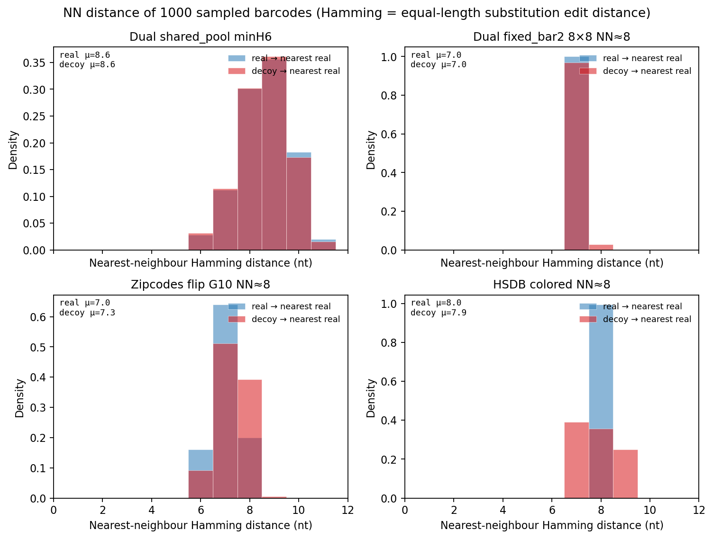

# Structure-matched decoys (four 235×363 arrays, NN≈8 redesign)

Decoy barcodes estimate assignment precision via \(\hat P = 1 - (D/A)/\phi\). Layouts below target **mean nearest-neighbour Hamming ≈ 7–9**.

## Layouts

| Array | Layout | Real NN μ | Design change |
|-------|--------|-----------|---------------|
| Dual shared_pool minH6 | `Dual_barcodes/layout_235x363_dual_shared_pool_g10_minH6.csv` | **8.6** | halves packed minH **6** |
| Dual fixed_bar2 8×8 | `…/layout_235x363_dual_fixed_bar2_8x8_g10_nn8.csv` | **7.0** | bar₂ minH **8**; bar₁ pack minH **7** |
| Zipcodes flip | `Zipcodes/output_235x363_flip_g10_h5_d12-16_far10/` | **7.0** | soft **12/14/16/16**, far **10** |
| HSDB | `HSDB/outputs/…_nn8_colored/` | **8.0** | bar₂ minH **8** + **block coloring** onto 16 bar₂ libraries |

HSDB note: a single reused bar₂ set left combined NN≈5 (far bar₁ collisions). Blocks are greedy-colored so any bar₁ pair with Hamming &lt; 8 gets different bar₂ sets (`layout_generator/color_bar2_for_nn.py`).

## Decoy outputs

| Array | Output | Construction | Decoy→real μ |
|-------|--------|--------------|--------------|
| Dual shared_pool minH6 | `output/dual_shared_pool_g10_minH6/` | packed-pool bar₂, `--target-nn 9` | **8.6** |
| Dual fixed_bar2 | `output/dual_fixed_bar2_8x8_g10_nn8/` | `mutate_bar1 --target-nn 8` | 7.0 |
| Zipcodes | `output/zipcodes_flip_g10_nn8/` | virtual axes + combined QC | 7.3 |
| HSDB | `output/hsdb_g10_nn8_colored/` | `mutate_bar1 --target-nn 8` | 7.9 |

## NN distance histograms



Blue = real→nearest real; red = decoy→nearest real (sample 1,000). Means align across arrays.

```bash
python plot_nn_distance_histograms.py --out-dir ../figures --sample 1000 --seed 1
```

## Activation-mask QC (synthesis cycle)

Photolithographic deprotection masks (same ACGT leftmost-illuminated rule as the manuscript). Cycle 1 should show:

- Dual shared_pool minH6 → **4×4** blocks  
- Dual fixed_bar2 → **8×8** blocks  
- Zipcodes → **full columns**  
- HSDB → **block-columns** (width 4)

```bash
python plot_activation_masks.py --cycle 1 --out-dir ../figures
```

Outputs: `figures/activation_masks_cycle1.png`, `figures/activation_masks_dual_zoom_cycle1.png`.

## Regenerate decoys

```bash
# Dual shared_pool minH6
python make_dual_decoys.py \
  --layout ../../Dual_barcodes/layout_235x363_dual_shared_pool_g10_minH6.csv \
  --library ../../Dual_barcodes/shared_pool_18nt_g10_minH.txt \
  --block-size 4 --bar1-len 18 --bar2-len 18 --bar2-mode library \
  --target-nn 9 --nn-tol 2 --g-max 0.10 --max-homopolymer 5 \
  --out-dir ../output/dual_shared_pool_g10_minH6

# Dual fixed / HSDB (distance-matched)
python make_dual_decoys.py --layout … --bar2-mode mutate_bar1 \
  --target-nn 8 --nn-tol 1 --g-max 0.10 --max-homopolymer 5 …

# Zip
python make_zip_decoys.py --layout … --fraction 1.0 --spacing bresenham \
  --g-max 0.10 --max-homopolymer 5 --candidates 12000 …
```
