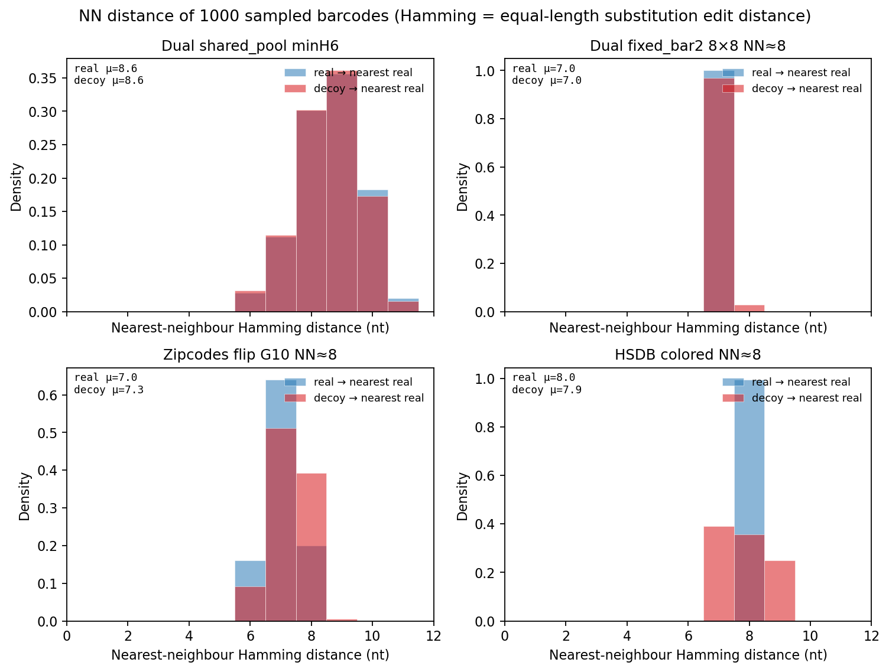

# Summary of four new 235×363 arrays (NN≈8)

All four designs target **235 × 363 = 85,305** spots and **36 nt** barcodes, with **G &lt; 10%** and **homopolymers ≤ 5**. Soft distance targets are in **bits**. Layouts were tuned so mean nearest-neighbour (NN) Hamming among real barcodes is **≈ 7–9**, with structure-matched decoys whose decoy→real NN matches real→real.

---

## 1. Zipcodes (flip mode, G threshold)

### Method

Zipcodes encode each feature as the concatenation of a **column code** and a **row code** (18 nt + 18 nt), with no separator. Each axis code is a **36-bit** binary string converted to DNA at 2 bits per nucleotide (printed mapping: 00→A, 01→C, 10→T, 11→G).

Codes are built along each axis with greedy search and backtracking. In **flip mode**, each new candidate flips a small number of bits in the preceding code. Soft targets set bit distance to codes 1–4 positions away; a hard **far** minimum applies beyond that. `require_tolerance` forces backtracking when no candidate meets the soft window. **G and homopolymer limits are enforced inside the candidate loop.**

To raise full-barcode NN from ~6.3 toward ~8, soft targets were stepped up from 8/10/12/12 to **12/14/16/16** (soft 14–18 / far 12 thrashing under G &lt; 10%).

| | |
|---|---|
| **Config** | `Zipcodes/config_235x363_flip_g10_h5_d12-16_far10.json` |
| **Output** | `Zipcodes/output_235x363_flip_g10_h5_d12-16_far10/` |
| **Soft targets** | **12 / 14 / 16 / 16** at offsets 1–4 |
| **Far min** | **10** bits |
| **G / HP** | G &lt; 10% per axis; HP ≤ 5 |
| **Unique barcodes** | 85,305 |
| **Real NN μ** | **7.0** |

### Achieved soft distances (bits)

| Offset | Target | X mean [min–max] | Y mean [min–max] |
|--------|--------|------------------|------------------|
| 1 | 12 | 11.95 [10–14] | 11.92 [10–14] |
| 2 | 14 | 14.02 [12–16] | 14.09 [13–16] |
| 3 | 16 | 15.97 [14–18] | 15.94 [14–17] |
| 4 | 16 | 15.99 [14–18] | 15.99 [14–18] |
| ≥5 (far) | ≥10 | 16.64 [10–…] | 16.65 [10–…] |

---

## 2. HSDB (24 nt Zipcode bar₁ + 12 nt bar₂, colored bar₂)

### Method

**Hierarchical Spatial Dual Barcodes (HSDB)** combine Dual’s block structure with Zipcodes’ spatial coding. The array is partitioned into **4×4 blocks**. Each block receives a unique **bar₁** of 24 nt (Zipcode-style 12+12 nt on the block grid, flip mode, soft **12/14/16/16**, far **8** on 24-bit axes, in-loop G/HP).

Spot **bar₂** codes are 12 nt with **min Hamming 8** (16 codes per set). A **single** reused bar₂ set left combined NN ≈ 5, because some non-adjacent bar₁ pairs still have DNA Hamming &lt; 8. Blocks are therefore **conflict-colored**: any bar₁ pair with Hamming &lt; 8 gets a **different** 16-code bar₂ library (**16 colors**, 256 bar₂ sequences total). Hierarchical decoding still works: bar₁ → block → bar₂ within that block’s set.

| | |
|---|---|
| **bar₁ config** | `HSDB/bar1_zipcode/block_zipcode_config_235x363_g10_h5_d12-16_far8_24nt.json` |
| **bar₁ out** | `HSDB/bar1_zipcode/235x363_g10_h5_d12-16_far8_24+12_nn8/` |
| **bar₂ base set** | `HSDB/bar2_library/spot_barcodes_12nt_g10_nn8.txt` (min Hamming **8**) |
| **Layout** | `HSDB/outputs/235x363_g10_h5_d12-16_far8_24+12_nn8_colored/` |
| **Coloring** | `HSDB/layout_generator/color_bar2_for_nn.py` → `block_bar2_colors.json` (16 colors; ~102k conflict edges) |
| **Soft / far** | 12 / 14 / 16 / 16; far ≥ **8** bits |
| **Blocks** | 59 × 91 = 5,369 |
| **G / HP** | max **8.3%** G; HP ≤ 5 |
| **Real NN μ** | **8.0** |

### Achieved soft distances (bits, bar₁ axes)

| Offset | Target | X mean | Y mean |
|--------|--------|--------|--------|
| 1 | 12 | 11.30 | 11.24 |
| 2 | 14 | 13.25 | 13.37 |
| 3 | 16 | 14.98 | 15.18 |
| 4 | 16 | 14.87 | 15.22 |

bar₁ spatial DNA (full 24 nt): adjacent mean **8.28** [6–11]; far (≥5 steps) mean 8.22 [5–12] — far DNA &lt; 8 is why coloring is required.

---

## 3. Dual — shared_pool with enforced Hamming (minH6)

### Method

**Dual barcodes** partition the array into blocks that share a common **bar₁**; spots inside a block get different **bar₂** halves. Uniqueness is the pair `(bar₁, bar₂)`.

This array keeps the printed Dual **4×4 shared_pool** structure (**18 + 18** nt), but replaces the in-house half library with a **Hamming-packed** pool: every pair of 18-mers has **Hamming ≥ 6** under G≤10% and HP≤5. Target minH 7 only yields ~4.4k codes — short of unique bar₁ for 5,369 blocks — so **minH 6 / 7,000** halves was used (seed **44**). Combined barcodes then have NN floor **6** and mean NN **≈ 8.6**.

| | |
|---|---|
| **Library** | `Dual_barcodes/shared_pool_18nt_g10_minH.txt` (7,000 × 18 nt, minH 6) |
| **Config** | `Dual_barcodes/config_235x363_shared_pool_g10_minH6.json` |
| **Output** | `Dual_barcodes/layout_235x363_dual_shared_pool_g10_minH6.csv` |
| **Seed** | **44** |
| **Blocks** | 59 × 91 = 5,369 |
| **G / HP** | mean G 5.1%, max **5.6%**; HP ≤ 5 |
| **Distinct bar₁ / bar₂** | 5,369 / 7,000 |
| **Real NN μ** | **8.6** (min 6) |
| **Decoy→real μ** | **8.6** |

---

## 4. Dual — `fixed_bar2`, 8×8 blocks (NN≈8)

### Method

Same Dual block logic, but bar₂ is a **small distance-designed repertoire** of size \(n_{\mathrm{bar2}} = B^{2}\), reused in every block. For **B = 8**: **1,380** blocks and **64** bar₂ sequences.

NN≈8 redesign: bar₂ **min Hamming 8**; bar₁ pool packed at **min Hamming 7** (requested 8; 7 achieved under full bar₂ compatibility + G&lt;10%). Each bar₁ must be QC-compatible with the full bar₂ set.

| | |
|---|---|
| **Config** | `Dual_barcodes/config_235x363_fixed_bar2_8x8_g10_nn8.json` |
| **Output** | `Dual_barcodes/layout_235x363_dual_fixed_bar2_8x8_g10_nn8.csv` |
| **bar₂** | `bar2_repertoire_8x8_18nt_g10_nn8.txt` — 64 × 18 nt, **min Hamming 8** |
| **bar₁** | `bar1_pool_18nt_g10_compatible_8x8_nn8.txt` — pack min Hamming **7** |
| **G / HP** | mean G 4.8%, max **5.6%**; HP ≤ 5 |
| **Distinct bar₁ / bar₂** | 1,380 / **64** |
| **Real NN μ** | **7.0** (all sampled NNs = 7) |

---

## Side-by-side

| Array | Structure | Soft / minH | Real NN μ | Decoy→real μ | G max |
|-------|-----------|-------------|-----------|--------------|-------|
| Zipcodes flip | 18+18 axes | soft 12/14/16/16, far ≥10 | **7.0** | 7.3 | &lt;10% |
| HSDB colored | 24+12 | soft 12/14/16/16; bar₂ minH 8 + 16 colors | **8.0** | 7.9 | 8.3% |
| Dual shared_pool minH6 | 18+18, 4×4 | halves minH **6** | **8.6** | **8.6** | 5.6% |
| Dual fixed_bar2 | 18+18, 8×8 | bar₂ minH 8; bar₁ minH 7 | **7.0** | **7.0** | 5.6% |

---

## Decoys

Design \(\phi = D/(D+A)\) is **1/3** for Dual-like sets; Zip uses global ~1/2 with local axis \(\phi \approx 1/3\). All decoys pass **G ≤ 10%**, **HP ≤ 5**.

| Array | Output | Construction |
|-------|--------|--------------|
| Dual shared_pool minH6 | `decoys/output/dual_shared_pool_g10_minH6/` | unused packed-pool bar₂, `--target-nn 9` |
| Dual fixed_bar2 | `decoys/output/dual_fixed_bar2_8x8_g10_nn8/` | `mutate_bar1 --target-nn 8` |
| Zipcodes | `decoys/output/zipcodes_flip_g10_nn8/` | virtual axis codes + combined QC |
| HSDB | `decoys/output/hsdb_g10_nn8_colored/` | `mutate_bar1 --target-nn 8` |

### NN distance histograms (sample = 1,000)



Details: `decoys/README.md`.

---

## Read simulation (labeled garbled reads)

Unequal walk channel (`simulation/`): **sub=0.04, ins=0.05, del=0.14**; insertion stays on the reference base; **no pad/truncate**. R1 = garbled read; **R2 = reverse_complement(R1)**. FASTQ headers include `true_barcode=` for precision scoring. See `simulation/README.md`.

| Preset | Output |
|--------|--------|
| Dual shared_pool minH6 | `simulation/output/dual_shared_pool_g10_minH6/` |
| Dual fixed_bar2 | `simulation/output/dual_fixed_bar2_8x8_g10_nn8/` |
| Zipcodes | `simulation/output/zipcodes_flip_g10_nn8/` |
| HSDB colored | `simulation/output/hsdb_g10_nn8_colored/` |

---

## How to regenerate

```bash
# 1 Zipcodes
cd Zipcodes
python generate_layout_235x363_zipcodes.py \
  config_235x363_flip_g10_h5_d12-16_far10.json \
  output_235x363_flip_g10_h5_d12-16_far10

# 2 HSDB bar1 + base bar2, then color for NN≈8
cd ../HSDB
python bar2_library/generate_spot_barcodes.py \
  --n 16 --length 12 --min-hamming 8 --g-max 0.10 --max-homopolymer 5 \
  --gc-min 0 --gc-max 1 --out bar2_library/spot_barcodes_12nt_g10_nn8.txt
python bar1_zipcode/generate_block_barcodes.py \
  --config bar1_zipcode/block_zipcode_config_235x363_g10_h5_d12-16_far8_24nt.json \
  --out-dir bar1_zipcode/235x363_g10_h5_d12-16_far8_24+12_nn8 \
  --bar2 bar2_library/spot_barcodes_12nt_g10_nn8.txt
python layout_generator/color_bar2_for_nn.py \
  --bar1 bar1_zipcode/235x363_g10_h5_d12-16_far8_24+12_nn8/bar1_barcodes.txt \
  --target-nn 8 --out-dir outputs/235x363_g10_h5_d12-16_far8_24+12_nn8_colored

# 3 Dual shared_pool minH6
cd ../Dual_barcodes
python generate_layout_235x363.py config_235x363_shared_pool_g10_minH6.json

# 4 Dual fixed_bar2 NN≈8
python generate_layout_235x363.py config_235x363_fixed_bar2_8x8_g10_nn8.json

# Decoys + NN figures + activation masks
cd ../decoys/scripts
# see decoys/README.md for per-array commands
python plot_nn_distance_histograms.py --out-dir ../figures --sample 1000 --seed 1
python plot_activation_masks.py --cycle 1 --out-dir ../figures

# Simulated reads (1M pairs each; sub/ins/del = 0.04/0.05/0.14)
cd ../simulation
for p in dual_shared_pool_g10_minH6 dual_fixed_bar2_8x8_g10_nn8 zipcodes_flip_g10_nn8 hsdb_g10_nn8_colored; do
  python make_reads.py --preset $p --out-dir output/$p --n-reads 1000000 --seed 1 \
    --srate 0.04 --irate 0.05 --drate 0.14
done
```
